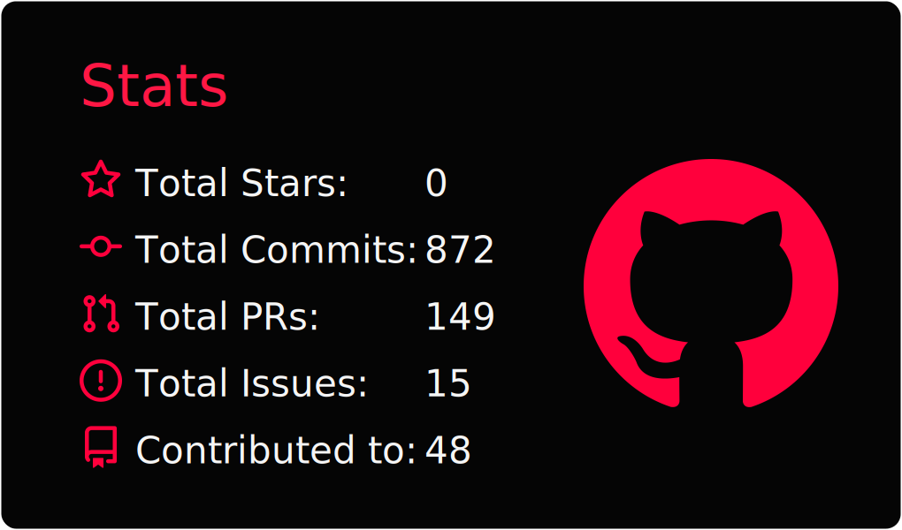
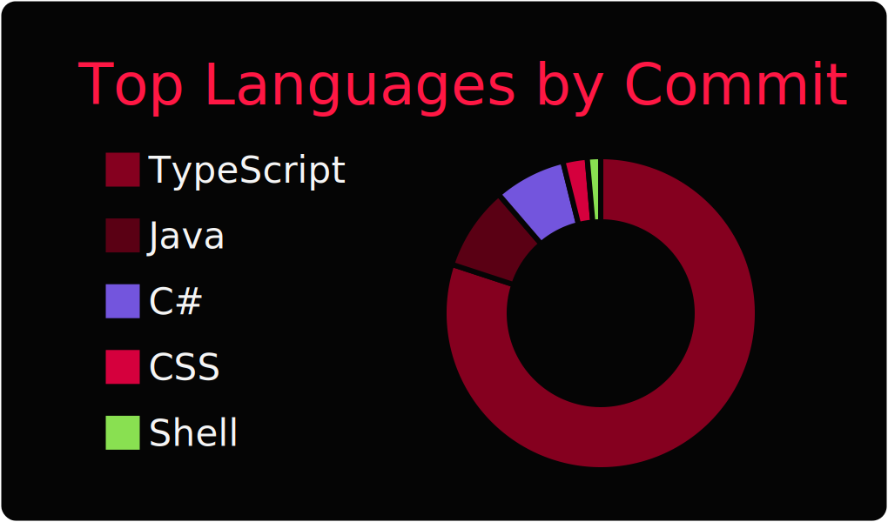
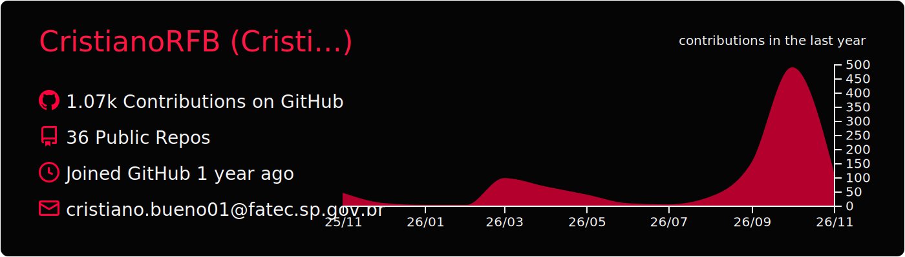
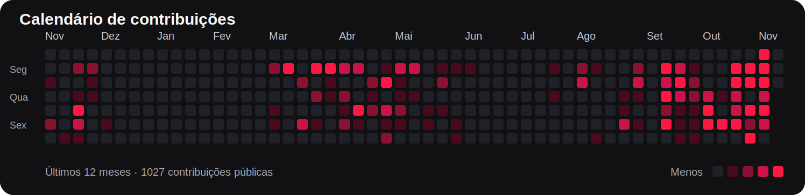
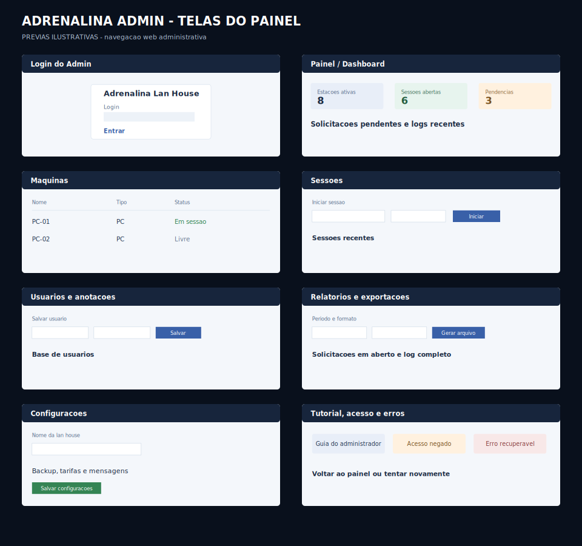

 

---

### Sobre mim

**Desenvolvedor Full Stack focado em SaaS**, produtos digitais e sistemas de gestão. Transformo necessidades de negócio em fluxos, interfaces e aplicações integradas.

ADS — Fatec Jales (em andamento) · Técnico em Desenvolvimento de Sistemas — ETEC (concluído)

---

<table>
<tr>
<td width="50%" align="center"></td>
<td width="50%" align="center"></td>
</tr>
</table>

 

Ver totais em texto (alternativa acessível)

<!-- PROFILE_STATS_START -->
| Indicador | Total | Histórico |
| :--- | ---: | :--- |
| Commits | **872** | [Ver commits](https://github.com/search?q=author%3ACristianoRFB&type=commits) |
| Pull requests | **142** | [Ver PRs](https://github.com/search?q=author%3ACristianoRFB&type=pullrequests) |
| Issues | **15** | [Ver issues](https://github.com/search?q=author%3ACristianoRFB&type=issues) |
| Repositórios com contribuições | **48** | [Ver atividade](https://github.com/CristianoRFB?tab=overview) |

Atualizado automaticamente em 06/11/2026 (horário de Brasília). Totais calculados pelo gerador de estatísticas do perfil; não representam apenas o ano atual.
<!-- PROFILE_STATS_END -->

---

## Projetos em destaque

### Caravana 77 — SaaS para organizadores

**Inscrições, financeiro, check-in e jornadas de organizadores e passageiros.** Em desenvolvimento.

 

 

### SaaS Food — Cardápio, pedidos e gestão

**Cardápio digital, pedidos, reservas, mesas com QR Code e painel administrativo.** Projeto para operação de restaurantes.

Imagens de referência visual versionadas no repositório.

 

 

<table>
<tr>
<td width="50%" valign="top">

### Adrenalina

Gestão de **lan house**, com aplicativo administrativo, cliente, servidor local e persistência de dados.

<code>.NET</code> <code>C#</code> <code>SQLite</code> <code>WinForms</code>

</td>
<td width="50%" valign="top">

### SIGO

Gestão de oficinas com **acompanhamento das alterações no veículo pelo cliente** e identificação das oficinas responsáveis.

<code>React</code> <code>TypeScript</code> <code>API REST</code>

</td>
</tr>
</table>

### Outros produtos e projetos

---

## Open source & contribuições

<table>
<tr>
<td width="50%" align="center" valign="top">

### Mihon

Leitura guiada por balões em um fork do leitor Android.

</td>
<td width="50%" align="center" valign="top">

### Learnmath

Projeto educacional colaborativo.

</td>
</tr>
</table>

### Experiência, idiomas e certificações

**Atuação:** desenvolvedor freelancer desde 2025 · designer gráfico freelancer desde 2022 · estudo de arquitetura SaaS multi-tenant e white-label.

**Certificações (2026):** Análise de Dados com Power BI · Arquitetura de Software e Performance · Como alavancar sua carreira com Power BI · Tendências e Carreira em Tecnologia da Informação.

Experiência e idiomas registrados no currículo; certificados e idiomas também constam no LinkedIn.

---

### Construindo SaaS, produtos e experiências digitais.

